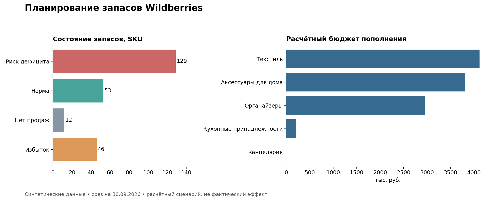

# Планирование закупок и товарных запасов Wildberries

**Автор: Герман · Аналитика закупок · SQL и Excel**

Учебный проект: определить приоритеты пополнения товаров и рассчитать объём заказа с учётом скорости продаж, запасов, срока пополнения, минимальной партии и кратности.

> Все данные синтетические. Товары, поставщики, цены и объёмы вымышлены. Структура полей вдохновлена рабочей отчётностью, но её реальные значения и строки не использованы. Выводы относятся только к учебному набору, достигнутый бизнес-эффект не заявляется.



## Задача бизнеса

Закупщик должен выбрать позиции для пополнения, не дублируя товары в пути и учитывая ограничения поставщика. Итог — расчётная очередь заказов и бюджет для проверки перед закупкой.

## Результаты расчёта

| Показатель | Значение |
|---|---:|
| Товаров (SKU) | 240 |
| Продано за 30 дней, шт. | 40 906 |
| Доступный запас, шт. | 39 268 |
| Входящие поставки, шт. | 2 729 |
| SKU с положительной рекомендацией заказа | 136 |
| Расчётный заказ, шт. | 19 791 |
| Расчётный бюджет, руб. | 11 099 288 |

### Основные выводы

1. **129 SKU имеют запас меньше срока пополнения.** Это основание проверить возможность ускорения поставки. Показатель не учитывает точную дату прибытия входящих поставок и не доказывает будущий дефицит.
2. **46 SKU превышают выбранный порог запаса.** Перед новыми заказами стоит проверить сезонность, планы продвижения и возможность переноса закупки.
3. **12 SKU не продавались за период.** Нельзя автоматически списывать их со счетов: нет истории доступности и данных о причинах отсутствия продаж.
4. Наибольший расчётный бюджет приходится на категорию **«Текстиль» — 4 118 220 руб.** Это приоритет для проверки бюджета, а не доказательство большей прибыльности категории.
5. Модель рекомендует пополнить **136 SKU**. Для утверждения заказа потребуются лимит бюджета, подтверждённые сроки поставок и актуальная доступность товаров у поставщика.

### Примеры позиций для первоочередной проверки

| SKU | Запас, дни | Срок пополнения, дни | Заказ, шт. | Бюджет, руб. |
|---|---:|---:|---:|---:|
| DEMO-0009 | 0.0 | 24 | 175 | 77 000 |
| DEMO-0049 | 0.0 | 12 | 40 | 12 400 |
| DEMO-0074 | 0.0 | 17 | 80 | 33 040 |
| DEMO-0104 | 0.0 | 29 | 204 | 155 448 |
| DEMO-0199 | 0.0 | 10 | 140 | 74 900 |

Полная очередь: [priority_orders.csv](results/priority_orders.csv).

## Данные и инструменты

- Excel: справочник, исходные данные и формулы расчёта; [скачать книгу](data/MP_FULL_synthetic.xlsx).
- SQLite: создание таблиц, проверки целостности, агрегации, CTE, JOIN и расчёт потребности.
- Python: перенос CSV в SQLite, выполнение SQL и проверка результата; анализ реализован в SQL, без pandas.
- Визуализация: статический обзор результатов. График не обновляется автоматически при редактировании Excel.

Набор включает 240 SKU, 7 200 ежедневных наблюдений продаж и 480 строк остатков. Продажи — 01–30 сентября 2026 года; остатки — единый срез на 30 сентября. Строка справочника — один SKU без размерных вариантов. [Словарь данных](docs/data_dictionary.md).

## Методика

1. Средние продажи в день = продажи за 30 календарных дней / 30.
2. Доступный запас = собственный склад + склад маркетплейса. Товары в пути учитываются отдельно.
3. Запас в днях = доступный запас / средние продажи. Если продаж нет, в SQL используется NULL. В Excel технически стоит 0 и отдельный статус «Нет продаж».
4. Чистая потребность = округление вверх от максимума между 0 и: продажи в день × (срок пополнения + 7 дней) − доступный запас − входящие поставки.
5. Положительный заказ округляется вверх до кратности, затем проверяется минимальная партия. В этом наборе минимальная партия кратна размеру партии.
6. Бюджет = заказ × вымышленная себестоимость единицы.

Статус «Риск дефицита»: запас в днях меньше срока пополнения. «Избыток»: запас выше срока пополнения + 7 + 30 дней. «Нет продаж» имеет приоритет над другими статусами. Статус и рекомендация заказа отвечают на разные вопросы: при запасе ниже срока поставки часть потребности уже может быть покрыта товаром в пути.

## Проверки качества

- Уникальность SKU, даты + SKU в продажах и даты + SKU + склада в остатках обеспечена ключами.
- Отрицательные количества и некорректные связи запрещены ограничениями базы.
- Продажи и остатки агрегируются до JOIN, чтобы не размножать количества.
- Сверены все 240 строк SQL с сохранёнными результатами Excel: продажи, запасы, потребность, заказ, бюджет и статус совпали.
- Проверены минимальная партия, кратность заказа и отсутствие ошибок формул в книге.

## Как воспроизвести

Требуется Python 3.10+ со стандартной библиотекой. Установка пакетов и сервер базы данных не нужны.

```bash
cd procurement-portfolio
python scripts/run_analysis.py
```

Период текущей версии: **01–30 сентября 2026 года**, срез остатков — **30.09.2026**. Даты учебные и не обозначают фактическую деятельность компании.

После перехода в `procurement-portfolio` запускать скрипт из этой папки. Скрипт заново создаёт `results/portfolio.sqlite` и CSV-отчёты. SQLite-база не хранится в Git. SQL находится в [sql/](sql/), исходные таблицы — в [data/](data/). Excel пересчитывается отдельно при изменении его входных данных; CSV — фиксированный снимок, автоматической синхронизации с книгой нет.

## Ограничения и дальнейшая проверка

- Предполагается, что входящие поставки придут к концу срока пополнения; точные даты неизвестны.
- Собственный запас считается сразу доступным маркетплейсу, без времени на перемещение и приёмку.
- Нет истории отсутствия товара, сезонности и ограничений бюджета. Средние продажи не равны полноценному прогнозу спроса.
- Бюджет не включает отдельные расходы на логистику, налоги и хранение; экономия и рост прибыли не измерялись.
- Статический график и готовые CSV относятся к исходному учебному сценарию. После изменения данных анализ нужно запустить заново; изображение в репозитории автоматически не перестраивается. Для его обновления установите matplotlib (`python -m pip install matplotlib`) и выполните `python scripts/plot_results.py`.

## Структура проекта

| Папка | Содержимое |
|---|---|
| `data/` | Синтетические CSV и Excel-книга |
| `sql/` | Схема базы, расчёт пополнения, аналитические запросы |
| `scripts/` | Воспроизводимый запуск на Python |
| `results/` | Очередь заказов, срезы по статусам и категориям, итоги |
| `assets/` | График результатов |
| `docs/` | Словарь данных, инструкции по публикации и защите проекта |

